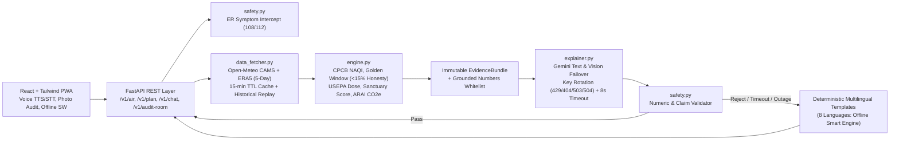

# PRANA-AI — Neuro-Symbolic Household Smog & Exposure Planner

**Track:** Google for Developers PromptWars Virtual — Challenge 06 (Urban Air Quality Assistant)

PRANA-AI converts raw Pan-India air-quality forecasts into constraint-aware daily household schedules, room ventilation guidance, and verified commute savings. Its core design principle is a **strict Neuro-Symbolic split**: **Python owns 100% of CPCB NAQI, boundary-layer meteorology, USEPA dosimetry, Sanctuary room scoring, and ARAI emission math**, packing results into an immutable `EvidenceBundle`; **Google Gemini only translates and explains** (or inspects room photos via Gemini Vision), guarded by a post-generation numeric validator, multi-key `429/404/503/504` failover, and a deterministic offline template engine.

---

## Live Deployment & 5-Minute Keep-Warm Setup

- **Live Web App URL:** `<YOUR_VERCEL_OR_RENDER_FRONTEND_URL>` _(deploy ready via [`render.yaml`](render.yaml) + Vite static frontend; set `VITE_API_BASE_URL` on the frontend and `ALLOWED_ORIGINS` on the backend)_
- **Backend Health Endpoint:** `GET /health` and `HEAD /health` -> `200 OK` (`{"status":"ok","app":"PRANA-AI","version":"1.0.0"}`)
- **Free 5-Minute Keep-Warm Ping (Prevents Cold Starts `<1s` Response):**
  1. **UptimeRobot (Recommended Free Tier):** Add a **HTTP(s)** monitor pointing to `https://<your-backend-domain>/health` with interval **5 minutes** (`HEAD` or `GET`—both are explicitly supported on `@app.api_route("/health", methods=["GET", "HEAD"])`).
  2. **Backup GitHub Actions Cron:** Included in [`.github/workflows/keep-warm.yml`](.github/workflows/keep-warm.yml) running every `*/5 * * * *`; simply add `PRANA_HEALTH_URL` under repository Settings -> Secrets -> Actions.

---

## Neuro-Symbolic Architecture



### Key Production Highlights

1. **Neuro-Symbolic Split (Zero Math Hallucinations):** Every concentration (`ug/m3`), CPCB NAQI sub-index, Golden Window interval, inhaled dose (`ug`), cigarette equivalent, and `CO2e` saving is calculated deterministically in Python (`backend/engine.py`). Any LLM response that invents ungrounded numbers, calls polluted air `"safe"`, or recommends houseplants for PM2.5 is automatically rejected by `safety.validate_narrative` and replaced seamlessly by a grounded deterministic template.
2. **Hard Medical Emergency Triage (`backend/safety.py`):** Queries mentioning acute distress (`wheezing`, `can't breathe`, `chest pain`, `blue lips`, `asthma attack`, `saans nahi`) are intercepted **before any LLM call** to trigger an urgent ER banner recommending India emergency numbers (`108 / 112`).
3. **Resilient `429 / 404 / 503 / 504` Key & Model Failover (`backend/explainer.py`):** Supports `GEMINI_API_KEY`, `GEMINI_API_KEY_BACKUP`, and comma-separated `GEMINI_API_KEYS`. Rotates immediately to the next key on `429 RESOURCE_EXHAUSTED` (with a 45s key cooldown), skips `404` unavailable models across `("gemini-2.5-flash", "gemini-2.0-flash", "gemini-3.5-flash-lite", "gemini-3.8-flash")` (600s cache), enforces an `8.0s` per-call `asyncio.wait_for` cap, reuses HTTP clients (`_CLIENT_CACHE`), and degrades cleanly to the `"Offline Smart Engine"`.
4. **Simulate Stale Data Toggle & Open-Meteo Failover (`backend/data_fetcher.py`):** Upstream API failures serve stale TTL cache when available or fall back to labeled historical replay (`PRANA-AI Historical Winter Replay (2025-11-18)`). Judges can verify offline/replay behavior live via the **Data & Judge Mode -> Simulate Stale Data** footer toggle.
5. **Consumer-Ready Features:** Pan-India geocoding (`/v1/geocode`), GPS reverse geocoding (`/v1/reverse-geocode`), 8 languages (`en`, `hinglish`, `hi`, `mr`, `kn`, `bn`, `ta`, `te`), Hour-by-Hour Breathability Strip + 5-Day Outlook, Web Speech `Listen` / `Voice Ask`, Gemini Vision Room IAQ Audit (`POST /v1/audit-room`, `₹0–₹500` fixes), 1-click School/Office Clean-Air Note generator, WhatsApp plan share, and iOS/Android installable PWA with phone permission management.

---

## Screenshots

| Hero Dashboard, 24h Inversion Curve & Clean-Air Note Alert | ER Medical Triage Intercept & Multilingual Ask AI | Simulate Stale Data Toggle & Room IAQ Photo Audit |
| :---: | :---: | :---: |
|  |  |  |

---

## Exact Deterministic Mathematical Formulas

All formulas and coefficients are stored in [`backend/data/constants.json`](backend/data/constants.json) and computed in [`backend/engine.py`](backend/engine.py):

### 1. CPCB India NAQI Sub-Index (`compute_cpcb_subindex`, `compute_hourly_naqi`)

For pollutant $p \in \{\text{PM}_{2.5}, \text{PM}_{10}, \text{NO}_2\}$ at concentration $C$:

$$
I_p = \text{round}\!\left(\frac{I_{\text{hi}} - I_{\text{lo}}}{C_{\text{hi}} - C_{\text{lo}}}(C - C_{\text{lo}}) + I_{\text{lo}}\right), \qquad \text{NAQI} = \max\!\big(I_{\text{PM}_{2.5}},\, I_{\text{PM}_{10}},\, I_{\text{NO}_2}\big)
$$

Continuous interval bridging smoothly interpolates between integer CPCB breakpoint boundaries (e.g., `30.0 < C < 31.0`), capped at `500`.

### 2. Dynamic Golden Window & `<15%` Flat-Curve Honesty Rule (`find_golden_window`)

Scans daytime sliding pairs $h \in \{7, \dots, 17\}$ for $\min \frac{\text{PM}_{2.5}(h) + \text{PM}_{2.5}(h+1)}{2}$ and compares against morning peak $P_{\text{am}} = \max_{h \in \{6..9\}} \text{PM}_{2.5}(h)$:

$$
\text{Reduction \%} = \frac{P_{\text{am}} - \overline{\text{PM}}_{2.5,\,\text{2h}}}{P_{\text{am}}} \times 100
$$

- If `NAQI <= 100` across the day -> classified as `is_clean_air_day`.
- Otherwise, `has_meaningful_window = True` **only if** $\text{Reduction} \ge 15\%$. When winter inversion stays flat (`<15%` dip), flexible strenuous activities for sensitive members are moved indoors instead of falsely cheering a minor dip.

### 3. Ledger 1 — USEPA Modeled PM2.5 Inhaled Dose Proxy (`Breathe Less`)

$$
D\,(\mu\text{g}) = C_{\text{out}} \times \kappa_{\text{microenv}} \times V_E \times \Delta t\,(\text{hr}) \times (1 - \eta_{\text{mask}})
$$

$$
\text{Cigarettes Avoided} = \frac{D_{\text{baseline}} - D_{\text{optimized}}}{330.0\,\mu\text{g}}
$$

- **Ventilation Rate $V_E$ ($\text{m}^3/\text{hr}$):** `sleep=0.45`, `seated=0.55`, `light_walk=1.25`, `elderly_walk=1.30`, `child_play=1.35`, `brisk_walk=1.60`, `running_or_outdoor_work=2.70`
- **Microenvironment Factor $\kappa$:** `open_road_2w_auto=1.55`, `walk_sidewalk=1.15`, `bus_non_ac=1.15`, `indoor_open=0.85`, `car_ac_recirc=0.80`, `electric_metro=0.55`, `indoor_shut=0.50`, `indoor_sealed=0.28`
- **Mask Efficiency $\eta$:** `none=0.00`, `cloth=0.20`, `surgical=0.35`, `n95=0.80`

### 4. Clean Air Sanctuary Room Scoring (`score_sanctuary`)

$$
\text{Room Score} = 100 - 15 \cdot N_{\text{ext\_windows}} - 25 \cdot \mathbb{1}_{\text{road\_facing}} - 25 \cdot \mathbb{1}_{\text{kitchen\_adjacent}} - 10 \cdot \mathbb{1}_{\text{large\_volume}}
$$

Timed ventilation opens non-road-facing windows for 20 minutes **only** when the daytime minimum outdoor $\text{PM}_{2.5} \le 90\,\mu\text{g/m}^3$; otherwise exterior windows stay shut and cooking smoke is exhausted locally with the kitchen door closed.

### 5. Ledger 2 — ARAI / WRI India Commute Emissions (`Emit Less`)

$$
\Delta\text{CO}_2\text{e}\,(\text{g}) = d_{\text{km}} \cdot (\text{EF}_{\text{CO}_2,\text{base}} - \text{EF}_{\text{CO}_2,\text{target}}), \qquad \Delta\text{PM}_{2.5,\text{tailpipe}}\,(\text{mg}) = d_{\text{km}} \cdot (\text{EF}_{\text{PM},\text{base}} - \text{EF}_{\text{PM},\text{target}})
$$

---

## Local Setup & Verification

### 1. Backend (`backend/`)

```bash
cd backend
python -m pip install -r requirements.txt
# Copy ../.env.example to ../.env and set optional keys/CORS:
#   GEMINI_API_KEY, GEMINI_API_KEY_BACKUP, GEMINI_API_KEYS (comma-separated), ALLOWED_ORIGINS
python -m uvicorn main:app --reload --port 8000
```

Run automated test suite:

```bash
python -m pytest -v backend/tests
```

### 2. Frontend (`frontend/`)

```bash
cd frontend
npm install
npm run dev      # http://localhost:5173 (proxies /api -> 127.0.0.1:8000)
# For Vercel/Render static deploys, set VITE_API_BASE_URL=https://<your-render-api>.onrender.com
npm run build    # Production bundle + PWA manifest & service worker in frontend/dist/
```

### Latest Verified Checks

- **`python -m pytest -v backend/tests`:** **26 passed** (`test_api.py`, `test_engine.py`, `test_explainer.py`, `test_safety.py`), covering Pan-India geocode/reverse-geocode, Open-Meteo `404/503/504` fallback, Gemini `429` key rotation + `404/503/504` failover + cooldown cache, category-specific `>100` vs `>150` NAQI risk thresholds across all 4 user types, `POST /v1/chat` trip planning & uncaught crash `200` guarantee, `/v1/audit-room` (`413` >5MB, `415` non-image, Vision & deterministic fallback), and ER `wheezing` triage.
- **`npm --prefix frontend run build`:** **2008 modules transformed**, built cleanly with `manifest.json`, `sw.js`, and PNG PWA icons emitted in `frontend/dist/`.
- **Health endpoint latency (local):** `GET /health` and `HEAD /health` both return `200 OK` in `~4–15 ms`.

---

## What Broke Along the Way & How Google Antigravity Helped

- **Gemini SDK Server Deadline Error (`400 Minimum allowed deadline is 10s`):** Passing a 5s `HttpOptions` timeout to `google-genai` failed server-side on newer keys, and `gemini-2.5-flash`/`gemini-2.0-flash` returned `404 NOT_FOUND` on key tiers requiring `gemini-3.5-flash-lite` / `gemini-3.8-flash`. Fixed with pooled `genai.Client` connections, Python-enforced `asyncio.wait_for(..., timeout=8.0)`, 600s `404` model skip caching, and 45s `429` key rotation.
- **Category Threshold Blindness on Clean/Moderate Days:** Switching between `Students & Kids`, `Seniors`, `Delivery Riders`, and `Adults` initially looked visually identical on `Good`/`Moderate` days; fixed by adding physiology-based `ProfileRiskSummary` thresholds (`NAQI > 100` warnings for Kids/Seniors/Riders vs `>150` for Adults) and upgrading `Delivery Rider` traffic-shift N95 protection above `20 ug/m3`.
- **Vite Proxy `500` Empty-Body Glitches & Keep-Warm `405`s:** Windows `localhost` IPv6 resolution (`::1`) and `HEAD` pings caused proxy/monitor errors; resolved via explicit `127.0.0.1:8000` Vite proxy targeting, trailing-slash sanitization on `VITE_API_BASE_URL` / `ALLOWED_ORIGINS`, nested `/v1/chat` fallback, and `@app.api_route("/health", methods=["GET", "HEAD"])`.
- **Built with Google Antigravity:** Used Google Antigravity across rapid backend/frontend scaffolding, systematic failure injection (`404/429/503/504` mocks), Playwright `1280px` & `390px` responsive audits, and continuous `pytest` + Vite build verification.

---

## Honest Limitations

1. **Gridded Satellite/Model Data vs. Hyperlocal Monitors:** Live forecasts come from Open-Meteo (`~11 km` ECMWF CAMS + ERA5 grid), which smooths hyperlocal roadside hotspots or construction plumes compared to a doorstep CPCB CAAQMS sensor.
2. **Modeled Exposure Proxy, Not Medical Telemetry:** USEPA breathing rates ($V_E$) and microenvironment multipliers ($\kappa$) represent standardized population averages—not individual spirometry or indoor laser sensor readings.
3. **Visual IAQ Estimates:** `POST /v1/audit-room` inspects visible room features (window gaps, exhaust placement, fabric dust traps) and explicitly excludes PM2.5 sensor claims.
4. **Device Voice & PWA Differences:** Web Speech synthesis (`speechSynthesis`) voice quality depends on OS language packs installed on a user's Android/iOS device; `SpeechRecognition` voice input gracefully hides on browsers without Web Speech STT support (such as Firefox).
5. **External Deployment & Keep-Warm:** `render.yaml`, `GET/HEAD /health`, and `.github/workflows/keep-warm.yml` are committed and tested locally, while provisioning the public host URL and external UptimeRobot monitor happens at deploy time.
