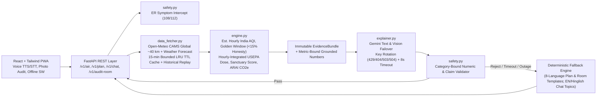
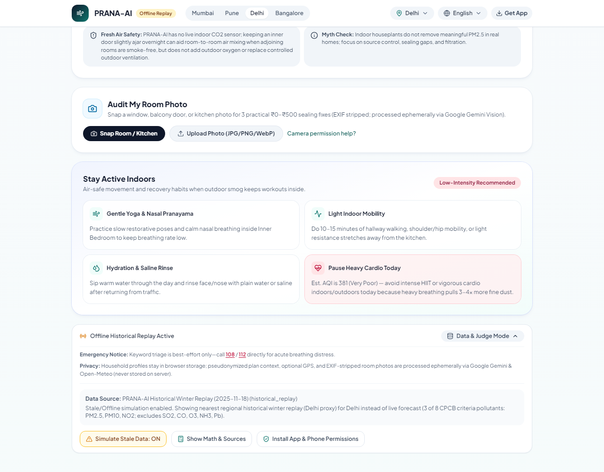

# PRANA-AI — Neuro-Symbolic Household Smog & Exposure Planner

**Track:** Google for Developers PromptWars Virtual — Challenge 06 (Urban Air Quality Assistant)

PRANA-AI converts raw Pan-India air-quality forecasts into constraint-aware daily household schedules, room ventilation guidance, and verified commute savings. Its core design principle is a **strict Neuro-Symbolic split**: **Python owns 100% of CPCB breakpoint math, boundary-layer meteorology, USEPA dosimetry, Sanctuary room scoring, and ARAI emission math**, packing results into an immutable `EvidenceBundle`; **Google Gemini only translates and explains** (or inspects room photos via Gemini Vision), guarded by a post-generation metric-bound numeric validator, multi-key `429/404/503/504` failover, and a deterministic fallback engine.

---

## Live Deployment & 5-Minute Keep-Warm Setup

- **Live Web App URL:** https://prana-ai-promptwars.vercel.app/ _(deploy ready via [`vercel.json`](vercel.json) full-stack routing and [`render.yaml`](render.yaml) backup; set `VITE_API_BASE_URL` and `ALLOWED_ORIGINS` if hosting backend/frontend separately)_
- **Backend Health Endpoint:** `GET /health` and `HEAD /health` -> `200 OK` (`{"status":"ok","app":"PRANA-AI","version":"1.0.0"}`)
- **Free 5-Minute Keep-Warm Ping (Prevents Cold Starts):**
  1. **UptimeRobot (Recommended Free Tier):** Add an **HTTP(s)** monitor pointing to `https://<your-backend-domain>/health` with interval **5 minutes** (`HEAD` or `GET`—both are explicitly supported on `@app.api_route("/health", methods=["GET", "HEAD"])`).
  2. **Backup GitHub Actions Cron:** Included in [`.github/workflows/keep-warm.yml`](.github/workflows/keep-warm.yml) running every `*/5 * * * *`; simply add `PRANA_HEALTH_URL` under repository Settings -> Secrets -> Actions.

## Demo Video

Watch the 2 minute 30 second demo video: [PRANA-AI Demo Video](https://drive.google.com/file/d/19EsjzZ44RImpyeHIlbGk8uoRgqjRx6Ag/view?usp=drivesdk) (Google Drive, no sign in needed). It shows the live app, a code walkthrough of the key parts, the challenges faced, and how Google Antigravity and Gemini helped build it.

---

## Neuro-Symbolic Architecture



### Key Production Highlights

1. **Neuro-Symbolic Split (Zero Math Hallucinations):** Every concentration (`ug/m3`), Estimated Hourly India NAQI sub-index, Golden Window interval, hourly-integrated inhaled dose (`ug`), cigarette equivalent, and `CO2e` saving is calculated deterministically in Python (`backend/engine.py`). Any LLM response that invents ungrounded metrics/percentages, swaps categories (e.g., citing a CO2 number as PM2.5), calls polluted air `"safe"`, or recommends houseplants for PM2.5 is automatically rejected by `safety.validate_narrative` and replaced seamlessly by a grounded deterministic template.
2. **Hard Medical Emergency Triage (`backend/safety.py`):** Queries mentioning acute distress (`wheezing`, `can't breathe`, `difficulty breathing`, `chest pain`, `blue lips`, `asthma attack`, `saans nahi`, plus Hindi/Devanagari distress phrases) are intercepted **before any LLM call** to trigger an urgent ER banner with tappable `108 / 112` links.
3. **Resilient `429 / 404 / 503 / 504` Key & Model Failover (`backend/explainer.py`):** Supports `GEMINI_API_KEY`, `GEMINI_API_KEY_BACKUP`, and comma-separated `GEMINI_API_KEYS`. Rotates immediately to the next key on `429 RESOURCE_EXHAUSTED` (with a 45s key cooldown), skips `404` unavailable models across `("gemini-3.5-flash-lite", "gemini-3.8-flash", "gemini-3.5-flash", "gemini-2.5-flash")` (600s cache), enforces an `8.0s` per-call `asyncio.wait_for` cap, reuses pooled HTTP clients (`_CLIENT_CACHE`), and degrades cleanly to the **Deterministic Fallback Engine**.
4. **Simulate Stale Data & Explicit Partial Provenance (`backend/data_fetcher.py`):** Upstream API failures serve stale LRU cache when available or fall back cleanly with explicit `is_partial_fallback` and `fallback_slots` tracking so forecast gaps never masquerade silently as pure live readings. Judges can test full offline replay via **Data & Judge Mode -> Simulate Stale Data**.
5. **Multilingual & Consumer Features:** Pan-India geocoding (`/v1/geocode`), GPS reverse geocoding (`/v1/reverse-geocode`), Hour-by-Hour Breathability Strip + 5-Day Outlook, Web Speech `Listen` / `Voice Ask`, Gemini Vision Room IAQ Audit (`POST /v1/audit-room`, `₹0–₹500` fixes), 1-click School/Office Clean-Air Note generator, WhatsApp plan share, WCAG AA accessible modals/controls, and installable iOS/Android PWA support.
   - **8-Language Scope:** Gemini-generated daily briefs, interactive chat replies, and Room IAQ photo audits support all **8 languages** (`en`, `hinglish`, `hi`, `mr`, `kn`, `bn`, `ta`, `te`). Deterministic fallback daily plans and fallback room-audit tips also render in all 8 languages, while offline deterministic chat uses English/Hinglish topic routing when Gemini is unavailable.

---

## Screenshots

| Hero Dashboard, 24h Inversion Curve & Clean-Air Note Alert | ER Medical Triage Intercept & Multilingual Ask AI | Simulate Stale Data Toggle & Room IAQ Photo Audit |
| :---: | :---: | :---: |
|  |  |  |

---

## Exact Deterministic Mathematical Formulas

All formulas and coefficients are externalized in [`backend/data/constants.json`](backend/data/constants.json) and computed in [`backend/engine.py`](backend/engine.py):

### 1. Estimated Hourly India CPCB NAQI Sub-Index (`compute_cpcb_subindex`, `compute_hourly_naqi`)

For pollutant $p \in \{\text{PM}_{2.5}, \text{PM}_{10}, \text{NO}_2\}$ at concentration $C$:

$$
I_p = \text{round}\!\left(\frac{I_{\text{hi}} - I_{\text{lo}}}{C_{\text{hi}} - C_{\text{lo}}}(C - C_{\text{lo}}) + I_{\text{lo}}\right), \qquad \text{Est. NAQI} = \max\!\big(I_{\text{PM}_{2.5}},\, I_{\text{PM}_{10}},\, I_{\text{NO}_2}\big)
$$

Continuous interval bridging smoothly interpolates between integer CPCB breakpoint boundaries (e.g., `30.0 < C < 31.0`), capped at `500`. Note: Official CPCB NAQI is a 24-hour running station average; PRANA-AI applies CPCB concentration breakpoints hour-by-hour for actionable scheduling.

### 2. Dynamic Golden Window & `<15%` Flat-Curve Honesty Rule (`find_golden_window`, `build_daily_outlook`)

Scans daytime sliding pairs $h \in \{7, \dots, 17\}$ for $\min \frac{\text{PM}_{2.5}(h) + \text{PM}_{2.5}(h+1)}{2}$ and compares against morning peak $P_{\text{am}} = \max_{h \in \{6..9\}} \text{PM}_{2.5}(h)$ across both today's 24h curve and all 5 outlook days:

$$
\text{Reduction \%} = \frac{P_{\text{am}} - \overline{\text{PM}}_{2.5,\,\text{2h}}}{P_{\text{am}}} \times 100
$$

- If `Est. NAQI <= 100` across the day -> classified as `is_clean_air_day`.
- Otherwise, `has_meaningful_window = True` **only if** $\text{Reduction} \ge 15\%$. When winter inversion stays flat (`<15%` dip), flexible strenuous activities for sensitive members are moved indoors instead of falsely cheering a minor dip.

### 3. Ledger 1 — Hourly-Integrated USEPA Inhaled Dose Proxy (`Breathe Less`)

Multi-hour shifts (such as 4h delivery blocks) integrate hour-by-hour across every occupied hourly concentration $C_{\text{out}}(h)$:

$$
D\,(\mu\text{g}) = \sum_{h} C_{\text{out}}(h) \times \kappa_{\text{microenv}} \times V_E \times \Delta t_h\,(\text{hr}) \times (1 - \eta_{\text{mask}})
$$

$$
\text{Cigarettes Avoided} = \frac{D_{\text{baseline}} - D_{\text{optimized}}}{330.0\,\mu\text{g}}
$$

- **Ventilation Rate $V_E$ ($\text{m}^3/\text{hr}$):** `sleep=0.45`, `seated=0.55`, `light_walk=1.25`, `elderly_walk=1.30`, `child_play=1.35`, `brisk_walk=1.60`, `running_or_outdoor_work=2.70`
- **Microenvironment Factor $\kappa$:** `open_road_2w_auto=1.55`, `walk_sidewalk=1.15`, `bus_non_ac=1.15`, `indoor_open=0.85`, `car_ac_recirc=0.80`, `electric_metro=0.55`, `indoor_shut=0.50`, `indoor_sealed=0.28`
- **Mask Efficiency $\eta$:** `none=0.00`, `cloth=0.20`, `surgical=0.35`, `n95=0.80`

### 4. Clean Air Sanctuary Room Scoring (`score_sanctuary`)

$$
\text{Room Score} = \text{clamp}_{[0,\,100]}\!\left(100 - 15 \cdot N_{\text{ext\_windows}} - 25 \cdot \mathbb{1}_{\text{road\_facing}} - 25 \cdot \mathbb{1}_{\text{kitchen\_adjacent}} - 10 \cdot \mathbb{1}_{\text{large\_volume}}\right)
$$

Timed exterior window opening is recommended **only** when the daytime minimum outdoor $\text{PM}_{2.5} \le \min(90\,\mu\text{g/m}^3,\, \text{modeled indoor baseline})$. Above that level, exterior windows remain shut and indoor $\text{CO}_2$ / cooking smoke is managed via closed-door kitchen exhaust rather than importing heavy street smog.

### 5. Ledger 2 — ARAI / WRI India Commute Emissions (`Emit Less`)

$$
\Delta\text{CO}_2\text{e}\,(\text{g}) = d_{\text{km}} \cdot (\text{EF}_{\text{CO}_2,\text{base}} - \text{EF}_{\text{CO}_2,\text{target}}), \qquad \Delta\text{PM}_{2.5,\text{tailpipe}}\,(\text{mg}) = d_{\text{km}} \cdot (\text{EF}_{\text{PM},\text{base}} - \text{EF}_{\text{PM},\text{target}})
$$

---

## Local Setup & Verification

### 1. Backend (`backend/`)

```bash
python -m pip install -r backend/requirements-dev.txt
# Copy .env.example to .env and set optional keys/CORS:
#   GEMINI_API_KEY, GEMINI_API_KEY_BACKUP, GEMINI_API_KEYS (comma-separated), ALLOWED_ORIGINS
python -m uvicorn main:app --app-dir backend --reload --port 8000
```

Run automated checks:

```bash
python -m ruff check backend
python -m mypy backend
python -m pytest -v backend/tests
```

### 2. Frontend (`frontend/`)

```bash
cd frontend
npm install
npm run dev      # http://localhost:5173 (proxies /api -> 127.0.0.1:8000)
npm run lint     # ESLint + jsx-a11y accessibility audit
npm run test     # Vitest + React Testing Library suite
npm run build    # Production bundle + PWA manifest & service worker in frontend/dist/
```

---

## What Broke Along the Way & How Google Antigravity Helped

- **Gemini SDK Server Deadline Error & November 2026 Model Failover:** Passing short `HttpOptions` timeouts to `google-genai` triggered server deadline validation errors, and newer Google AI Studio keys return `404 NOT_FOUND` on retired `gemini-2.0-flash` and restricted `gemini-2.5-flash*` endpoints (redirecting to `gemini-3.5-flash-lite` / `gemini-3.8-flash`). Resolved via pooled `genai.Client` instances, Python-enforced `asyncio.wait_for(..., timeout=8.0)`, prioritized 3.x + legacy failover `("gemini-3.5-flash-lite", "gemini-3.8-flash", "gemini-3.5-flash", "gemini-2.5-flash")` with 600s `404` caching, and 45s `429` key rotation.
- **Category Threshold Blindness & Multi-Hour Dosimetry:** Switching between `Students & Kids`, `Seniors`, `Delivery Riders`, and `Adults` initially looked too uniform on `Moderate` days and undercounted multi-hour shift changes; fixed with distinct physiology thresholds (`Est. NAQI > 100` for sensitive/outdoor-shift profiles vs `> 150` for Adults) and hourly-integrated dosimetry across 4h–8h shifts.
- **Single-Pass Stream Read & Request Race Conditions:** Rewrote `auditRoomPhoto` to read error/success response bodies once via `res.text()`, added `AbortController` + request sequence guards to debounced What-If sliders, and added Starlette `StripApiPrefixMiddleware` so both `/v1/*` and `/api/v1/*` work cleanly across local proxy and Vercel serverless routing.
- **Built with Google Antigravity:** Used Google Antigravity across backend/frontend modular refactoring, systematic failure injection (`404/429/503/504` mocks), WCAG AA accessibility fixes, Vitest + ESLint + Ruff + Mypy CI automation, and continuous build verification.

---

## Prompts Used

The app was built with Google Antigravity, and Gemini is guided by two system prompts in `backend/explainer.py`. Python computes every number first and packs it into an `EvidenceBundle`; Gemini only explains the precomputed facts in plain family language.

### 1. Grounded plan and chat explainer (`SYSTEM_PROMPT`)

"You are PRANA-AI, a warm, helpful neighbor and family air-quality guide in India. You receive precomputed air and schedule facts in JSON." The prompt sets strict rules: never invent, recalculate, round, or alter any number from the JSON; keep PM2.5 concentration and India NAQI separate; keep personal exposure avoided separate from travel CO2e saved; never call any polluted outdoor window "safe"; never recommend indoor houseplants for PM2.5 removal; avoid technical jargon; respect fixed commitments like school, work, and delivery shifts; state clearly when live data is unavailable and historical replay is used; and match the user's language in a warm, friendly 8th-grade reading level.

### 2. Room photo audit (`VISION_SYSTEM_PROMPT`)

"You are PRANA-AI, an indoor air quality specialist helping Indian families lower indoor PM2.5 at low cost (Rs 0 to Rs 500)." The prompt asks Gemini Vision to inspect the uploaded room or kitchen photo for ventilation and dust issues (window and door gaps, kitchen exhaust fan placement, soft dust traps) and return strict JSON only with exactly 3 tips costing Rs 0 to Rs 500, each with a short title, a specific step, and a simple reason. It also forbids houseplant recommendations and invented sensor numbers.

---

## Honest Limitations

1. **Coarse Gridded Global Model vs. Hyperlocal Monitors:** Live air forecasts come from Open-Meteo's **CAMS Global (`~0.4 deg` / `~40 km`, 3-hourly interpolated)** model paired with NWP weather forecasts (wind/PBLH), which smooths street-canyon traffic plumes or construction hotspots compared to a nearby CPCB CAAQMS reference station.
2. **Estimated Hourly CPCB NAQI Proxy vs. 24h Station Average:** Official India CPCB NAQI is defined over a 24-hour station running average; PRANA-AI maps each hourly forecast pollutant concentration through CPCB breakpoints as an **Estimated Hourly India AQI** for intraday timing decisions.
3. **Modeled Exposure Proxy, Not Medical Telemetry:** USEPA breathing rates ($V_E$) and microenvironment multipliers ($\kappa$) represent standardized population averages — not individual spirometry or calibrated indoor optical particle readings.
4. **8-Language Fallback Boundaries:** All **8 Indian languages** (`en`, `hinglish`, `hi`, `mr`, `kn`, `bn`, `ta`, `te`) work natively for Gemini plans/chat/room-audits as well as deterministic daily plans and room-audit fallbacks; when Gemini is offline or rate-limited, deterministic chat answers route topics in English/Hinglish while referencing live metrics.
5. **Visual IAQ Estimates & Device Voice Differences:** `POST /v1/audit-room` inspects visible room features and excludes unverified PM2.5 sensor claims; browser Web Speech synthesis/STT availability depends on OS language packs and HTTPS mobile permissions.

## Future Improvements

1. Hyperlocal CPCB station / low-cost sensor fusion alongside Open-Meteo `~40 km` CAMS Global forecasts so street-level hotspots show cleanly.
2. Indoor PM2.5/CO2 sensor pairing for the room audit, replacing modeled indoor baselines with live telemetry.
3. Web Push alerts when a meaningful daytime Golden Window opens (`>=15%` improvement).
4. Full 8-language deterministic Q&A intent routing alongside existing 8-language plan templates.
5. Offline-first cached last forecast snapshots paired with IndexedDB persistence when cellular connectivity drops.
6. School and outdoor-fleet coordinator dashboards for synchronized low-exposure shift and assembly scheduling.
