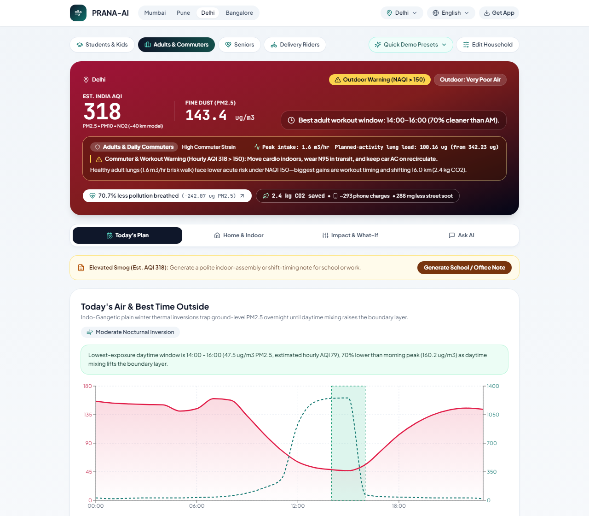
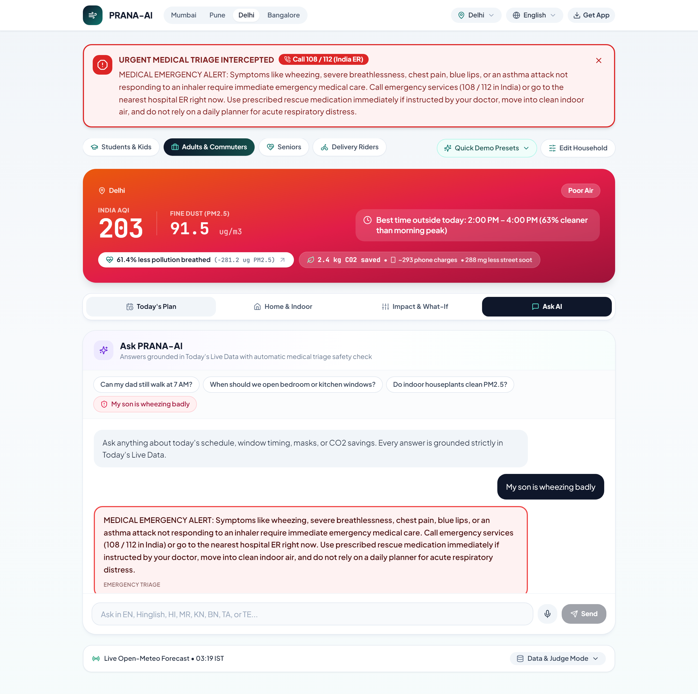
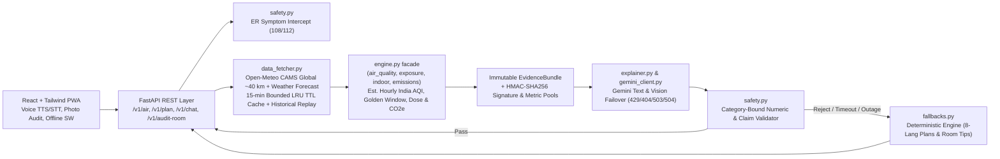

# PRANA-AI — Neuro-Symbolic Household Smog & Exposure Planner

**Track:** Google for Developers PromptWars Virtual — Challenge 06 (**Urban Air Quality Assistant**)

> **Turn city smog numbers into honest, constraint-aware daily schedules, indoor shelter plans, and verified travel savings across 8 Indian languages — without LLM math hallucinations.**

| Live Web App | Demo Video (2m 30s) | Health Check |
| :--- | :--- | :--- |
| **[prana-ai-promptwars.vercel.app](https://prana-ai-promptwars.vercel.app/)** | **[Watch Walkthrough on Google Drive](https://drive.google.com/file/d/19EsjzZ44RImpyeHIlbGk8uoRgqjRx6Ag/view?usp=drivesdk)** _(no sign-in)_ | `GET` / `HEAD` `/health` -> `200 OK` |

**Quick Navigation:** [Problem & Solution](#problem-solution-and-impact) • [Key Features](#key-features) • [Screenshots](#screenshots) • [Architecture](#architecture-overview) • [Project Structure](#project-structure-and-tech-stack) • [Setup & Tests](#installation-execution-and-testing) • [Quality Evidence](#engineering-quality-and-verification-evidence) • [Methodology & Safety](#scientific-methodology-and-safety-boundaries)

---

## Problem, Solution, and Impact

### Why Generic AQI Apps Fail Families in India
Most consumer air-quality apps only report a single raw AQI number or tell everyone to *"just stay home"*—advice that breaks down when children have morning school buses, seniors need respiratory protection thresholds early, and delivery riders work fixed 4–8 hour road shifts. Worse, feeding raw numbers directly to an LLM risks **invented concentrations, mixed-up $\text{PM}_{2.5}$ vs. AQI scales, missed indoor sources (tadka, agarbatti), and misleading "safe window" advice** during flat winter inversions.

### Our Neuro-Symbolic Solution & Real-World Impact
PRANA-AI enforces a strict **Neuro-Symbolic architecture**:
- **Symbolic Python (`engine.py` facade) owns 100% of the math:** Hourly India CPCB NAQI sub-indices, boundary-layer (`PBLH`) diurnal Golden Windows with a `<15%` flat-curve honesty rule, hourly-integrated USEPA inhaled lung-dose proxies (`Breathe Less`), Clean Air Sanctuary room scoring (`0–100`), and ARAI/WRI commute emissions (`Emit Less`) are packed into an HMAC-SHA256-signed `EvidenceBundle`.
- **Google Gemini only translates, explains & visually audits rooms:** Reads precomputed server JSON (zero arithmetic in the LLM), translates into **8 Indian languages** (`en`, `hinglish`, `hi`, `mr`, `kn`, `bn`, `ta`, `te`), and evaluates room photos for practical **Rs 0–Rs 500** fixes. A post-generation validator catches any ungrounded numbers or banned claims (e.g., recommending houseplants for $\text{PM}_{2.5}$) and seamlessly falls back to a **Deterministic Fallback Engine** so the app never crashes—even offline or without an API key.

---

## Key Features

- **4 Real-World Vulnerability Profiles & Custom Household Builder:** Switch between `Students & Kids`, `Seniors`, `Delivery Riders`, and `Adults & Commuters` (or customize members including infants age `0+`, rooms, and fixed vs. flexible schedules). Profile alerts adapt deterministically (`Est. NAQI > 100` for sensitive/road-shift profiles vs. `> 150` for adults).
- **Dynamic Golden Window & 5-Day Outlook (`<15%` Flat-Curve Honesty Rule):** Detects the cleanest daytime 2-hour window against morning inversion peaks across today's 24h forecast and all 5 outlook days, refuses to label stagnant winter pollution `"safe"`, and keeps fixed shifts protected with N95/route harm reduction.
- **Pre-LLM Medical Emergency Triage (`108 / 112`):** Queries mentioning acute distress (`wheezing`, `can't breathe`, `difficulty breathing`, `chest pain`, `blue lips`, `asthma attack`, `saans nahi`, plus Hindi/Gujarati/Bengali/Tamil/Telugu phrases) short-circuit **before rate limiting and before any LLM call** to surface an ER alert with tappable `108 / 112` dial links.
- **Separated Dual Impact Ledgers + Show-Math Audit:** Strictly decouples personal **Breathe Less** inhaled dose avoided ($\mu\text{g}$ & Berkeley Earth cigarette equivalents) from **Emit Less** transport savings ($\text{CO}_2\text{e}$ & tailpipe $\text{PM}_{2.5}$), with a transparent **Show Math** formula substitution modal.
- **Gemini Vision Room IAQ Photo Audit (`POST /v1/audit-room`):** Analyzes room/kitchen photos for window/door gaps, exhaust placement, and dust traps, returning 3 actionable **Rs 0–Rs 500** steps (5 MB streaming cap, JPG/PNG/WebP check, decompression-bomb guard, EXIF metadata stripped cleanly).
- **Pan-India Live Data, GPS & Offline Historical Replay:** Combines live Open-Meteo `~40 km` CAMS Global + weather forecasts, `/v1/geocode`, `/v1/reverse-geocode`, bounded `15-min` LRU caching, explicit `is_partial_fallback` provenance, and **Data & Judge Mode -> Simulate Stale Data**.
- **Accessible Daily Tools:** Web Speech **Listen / Voice Ask**, 1-click School/Office **Clean-Air Note** generator, WhatsApp plan summary sharing, keyboard-accessible WAI-ARIA `tablist` navigation, and installable iOS/Android PWA support.

---

## Screenshots

| Hero Dashboard, 24h Inversion Curve & Clean-Air Note Alert | ER Medical Triage Intercept & Multilingual Ask AI | Simulate Stale Data Toggle & Room IAQ Photo Audit |
| :---: | :---: | :---: |
|  |  |  |

---

## Architecture Overview



> Deep dive into all 15 backend modules, REST API endpoints, Gemini prompt contracts (`SYSTEM_PROMPT` & `VISION_SYSTEM_PROMPT` in [`backend/explainer.py`](backend/explainer.py)), failover state machine, and engineering lessons learned with Google Antigravity: **[docs/ARCHITECTURE.md](docs/ARCHITECTURE.md)**

---

## Project Structure and Tech Stack

### Tech Stack
- **Backend:** Python 3.12, FastAPI, Pydantic v2, httpx (async), Pillow (EXIF/image guard), `google-genai` (`gemini-3.5-flash-lite` -> `gemini-3.8-flash` -> `gemini-3.5-flash` -> `gemini-2.5-flash` failover), Uvicorn.
- **Frontend:** React 18, Vite 6 (`target: "es2022"`, chunked Recharts + Lucide icons), Tailwind CSS 3, Web Speech API, PWA Service Worker (`sw.js`).
- **Quality & CI Tooling:** Ruff (lint + `C901` complexity + Bugbear), Pylint, Mypy, Pytest, ESLint + `eslint-plugin-jsx-a11y`, Vitest + React Testing Library, `scripts/smoke.py`.
- **Hosting:** Full-stack Vercel routing ([`vercel.json`](vercel.json)) with Render Python API config ([`render.yaml`](render.yaml)).

### Repository Layout
```text
.
├── backend/
│   ├── main.py                # FastAPI entrypoint & REST routes (/health, /v1/*)
│   ├── schemas.py             # Strict Pydantic v2 contracts (extra="forbid")
│   ├── request_guards.py      # Prefix strip, security headers, origin check, bounded rate limiter
│   ├── engine.py              # Symbolic planning facade & signed metric allowlists
│   ├── air_quality.py         # CPCB NAQI sub-indices, Golden Window & 5-day outlook
│   ├── exposure.py            # Hourly USEPA dose model & constraint-aware routine optimizer
│   ├── indoor.py              # Clean Air Sanctuary scorer & cooking/ventilation thresholds
│   ├── emissions.py           # ARAI / WRI commute CO2e & tailpipe PM2.5 calculations
│   ├── data_fetcher.py        # Async Open-Meteo AQ/Weather/Geocode + 900s LRU TTL cache + replay
│   ├── geo_india.py           # External JSON loader, city presets & state language inference
│   ├── safety.py              # Pre-LLM 108/112 ER triage, HMAC-SHA256 & claim/numeric validator
│   ├── gemini_client.py       # Pooled genai.Client, 429 key cooldown, 404 model cache & 8s cap
│   ├── explainer.py           # System/Vision prompt orchestrator & evidence serializer
│   ├── fallbacks.py           # 8-language deterministic plan/room templates & EN/Hinglish Q&A
│   ├── image_audit.py         # 5 MB streaming upload guard, Pillow bomb cap & EXIF stripping
│   ├── data/                  # Externalized constants.json, presets.json, fallback_replay.json
│   └── tests/                 # 6 unit & integration suites (51 pytest tests)
├── frontend/
│   └── src/
│       ├── App.jsx            # Dashboard shell & error boundary composition
│       ├── api/client.js      # Timeout/retry fetch client + AbortController propagation
│       ├── hooks/             # usePranaPlan.js & pure planReducer.js state transitions
│       ├── components/        # Modular UI panels (HeaderBar, HeroAirCard, SmogChartCard, etc.)
│       ├── utils/ & data/     # Formatters, PWA helpers, and UI constants
│       └── __tests__/         # 12 Vitest + RTL test files (30 frontend tests)
├── docs/                      # ARCHITECTURE.md, METHODOLOGY.md, DEPLOYMENT.md, BUILD_IN_PUBLIC.md, screenshots/
├── scripts/smoke.py           # End-to-end API, HMAC 403, CSRF Origin & upload 415 smoke script
├── SECURITY.md                # Threat model, verified controls & vulnerability disclosure policy
├── vercel.json / render.yaml  # Production routing, CSP/HSTS headers & deployment specs
└── .github/workflows/         # CI verification gate (ci.yml) & optional 5-min ping (keep-warm.yml)
```

---

## Installation, Execution, and Testing

### Prerequisites
- **Python 3.12+** and **Node.js 22+** (matching [`.github/workflows/ci.yml`](.github/workflows/ci.yml))
- **Optional Google AI Studio Key:** Add `GEMINI_API_KEY` (or comma-separated `GEMINI_API_KEYS`) for live Gemini wording & room vision audits. Without a key, PRANA-AI automatically runs end-to-end via the Deterministic Fallback Engine.

### Environment Variables (`.env.example`)
Copy [`.env.example`](.env.example) to `.env` in the repository root:
- `GEMINI_API_KEY` / `GEMINI_API_KEY_BACKUP` / `GEMINI_API_KEYS` — Google AI Studio credentials (server-only, never exposed to Vite `VITE_*`).
- `PRANA_BUNDLE_SECRET` — Dedicated HMAC-SHA256 signing secret (recommended in production so signatures persist across restarts).
- `ALLOWED_ORIGINS` — Allowlisted frontend origins (`http://localhost:5173,http://127.0.0.1:5173,https://prana-ai-promptwars.vercel.app`).
- `VITE_API_BASE_URL` — Set only if deploying frontend and backend on separate origins (defaults to `/api`).

> Deployment setup ([`vercel.json`](vercel.json) & [`render.yaml`](render.yaml)) and free 5-minute keep-warm setup (UptimeRobot `HEAD`/`GET /health` + [`.github/workflows/keep-warm.yml`](.github/workflows/keep-warm.yml) with `PRANA_HEALTH_URL`): **[docs/DEPLOYMENT.md](docs/DEPLOYMENT.md)**

### Local Development
**1. Start Backend (`http://127.0.0.1:8000`)**
```bash
python -m pip install -r backend/requirements-dev.txt
python -m uvicorn main:app --app-dir backend --reload --port 8000
```

**2. Start Frontend (`http://localhost:5173`, proxies `/api` -> `127.0.0.1:8000`)**
```bash
cd frontend
npm install
npm run dev
```

### Automated Verification Commands
```bash
# Backend: Lint, Complexity (C901 <= 10), Pylint, Static Types, Tests & Contract Smoke
python -m ruff check backend
python -m ruff check --select C901,B backend
python -m pylint --disable=too-many-locals,fixme backend/*.py
python -m mypy backend
python -m pytest -v backend/tests
python scripts/smoke.py

# Frontend: ESLint + jsx-a11y, Vitest + React Testing Library & Production Bundle
npm --prefix frontend run lint
npm --prefix frontend run test
npm --prefix frontend run build
```

---

## Engineering Quality and Verification Evidence

All quality, safety, and resilience claims below reflect concrete code implementations and automated checks configured in this repository rather than external estimates:

| Quality Pillar | Implemented Controls | Verification Path & Documentation |
| :--- | :--- | :--- |
| **Code Quality** | 15 single-responsibility backend modules (`engine.py` facade, isolated `gemini_client.py`, `fallbacks.py`, `request_guards.py`); strict Pydantic schemas; Vite + React reducer/hook decomposition (`planReducer.js`). | Enforced via `ruff` (`E,F,W,I,UP,B,SIM` + `C901`), `pylint`, `mypy`, and `eslint` in [`.github/workflows/ci.yml`](.github/workflows/ci.yml). |
| **Security** | Server-only secrets; HMAC-SHA256 bundle signing (`403` on tamper); pre-LLM ER triage; CSRF `Origin` checks; proxy-trusted IP rate limits (`120 req/60s`); 5 MB JPG/PNG/WebP EXIF strip & pixel-bomb cap; CSP/HSTS/COOP/`nosniff` headers. | Verified in `backend/tests/test_safety.py`, `test_request_guards.py`, `test_api.py`, [`scripts/smoke.py`](scripts/smoke.py), and detailed in [`SECURITY.md`](SECURITY.md). |
| **Efficiency** | Bounded `900s` / `256`-entry LRU Open-Meteo cache; concurrent async AQ+weather fetches; `8.0s` LLM `asyncio.wait_for` cap with pooled clients; `429`/`404` cooldown caches; client `AbortController` + split Recharts/Lucide Vite chunks. | Verified in `backend/tests/test_data_fetcher.py`, `test_explainer.py`, and [`frontend/vite.config.js`](frontend/vite.config.js). |
| **Testing** | **51** backend pytest tests across 6 suites (`test_api`, `test_data_fetcher`, `test_engine`, `test_explainer`, `test_request_guards`, `test_safety`), **6** API/security smoke checks, and **30** Vitest + RTL tests across 12 frontend suites. | Runnable directly via `pytest`, `python scripts/smoke.py`, and `npm --prefix frontend run test`. |
| **Accessibility** | `eslint-plugin-jsx-a11y` flat audit; WAI-ARIA `tablist` arrow/Home/End keyboard switching; focus-preserving accessible modals; `role="alert"` / `aria-live="polite"` triage & hourly announcements; Web Speech TTS/STT & responsive layouts. | Verified in `frontend/src/__tests__/a11yAndModal.test.jsx`, `EmergencyBanner.test.jsx`, and `npm --prefix frontend run lint`. |
| **Problem Alignment** | Solves **Challenge 06 (Urban Air Quality Assistant)** for Indian households: Pan-India locations, CPCB NAQI + PBLH curves, constraint-aware schedules, Rs 0–500 room photo fixes, equity mode for outdoor workers, and 8-language support. | Cross-referenced across [`docs/METHODOLOGY.md`](docs/METHODOLOGY.md) and [`docs/BUILD_IN_PUBLIC.md`](docs/BUILD_IN_PUBLIC.md). |

---

## Scientific Methodology and Safety Boundaries

All equations use externalized constants in [`backend/data/constants.json`](backend/data/constants.json) — complete breakpoint tables, source DOIs/URLs, and coefficients are documented in **[docs/METHODOLOGY.md](docs/METHODOLOGY.md)**:

1. **Estimated Hourly India CPCB NAQI:** $I_p = \text{round}\!\left(\frac{I_{\text{hi}} - I_{\text{lo}}}{C_{\text{hi}} - C_{\text{lo}}}(C - C_{\text{lo}}) + I_{\text{lo}}\right)$, taking $\max(I_{\text{PM}_{2.5}}, I_{\text{PM}_{10}}, I_{\text{NO}_2})$ using official CPCB breakpoints hourly so morning/evening spikes remain visible.
2. **Dynamic Golden Window & `<15%` Rule:** $\text{Reduction \%} = \frac{P_{\text{am}} - \overline{\text{PM}}_{2.5,\,\text{2h}}}{P_{\text{am}}} \times 100$ — marks `has_meaningful_window = True` only when daytime air improves $\ge 15\%$ vs. morning peak (`06:00–09:00`); `is_clean_air_day = True` only if Est. NAQI $\le 100$ all day.
3. **USEPA Inhaled Dose Proxy (`Breathe Less`):** $D\,(\mu\text{g}) = \sum_h C_{\text{out}}(h) \cdot \kappa_{\text{microenv}} \cdot V_E \cdot \Delta t_h \cdot (1 - \eta_{\text{mask}})$, converted via Berkeley Earth benchmark (`330 ug` $\approx 1\text{ cigarette}$).
4. **Sanctuary Room Scoring:** $\text{clamp}_{[0,100]}(100 - 15 N_{\text{ext\_windows}} - 25 \cdot \mathbb{1}_{\text{road}} - 25 \cdot \mathbb{1}_{\text{kitchen}} - 10 \cdot \mathbb{1}_{\text{large}})$, opening exterior windows only when daytime minimum $\text{PM}_{2.5} \le \min(90\,\mu\text{g/m}^3, \text{indoor baseline})$.
5. **ARAI / WRI Commute Emissions (`Emit Less`):** $\Delta\text{CO}_2\text{e} = d_{\text{km}}(\text{EF}_{\text{CO}_2,\text{base}} - \text{EF}_{\text{CO}_2,\text{target}})$ and $\Delta\text{PM}_{2.5,\text{tailpipe}} = d_{\text{km}}(\text{EF}_{\text{PM},\text{base}} - \text{EF}_{\text{PM},\text{target}})$.

### Honest Limitations
1. **Gridded Model Resolution (`~40 km` CAMS Global):** Open-Meteo's CAMS Global model (`~0.4 deg`) smooths hyperlocal street-canyon traffic plumes or construction hotspots compared to a nearby CPCB CAAQMS monitor.
2. **Hourly Breakpoint Proxy vs. 24h CPCB Bulletin:** Official CPCB NAQI uses a 24-hour station running average; PRANA-AI applies CPCB breakpoints hourly for intraday scheduling.
3. **Modeled Exposure Proxy, Not Clinical Telemetry:** Standardized USEPA inhalation rates ($V_E$) and microenvironment multipliers ($\kappa$) do not replace spirometry or physical indoor PM2.5/CO2 sensors.
4. **8-Language Fallback Boundaries:** All 8 languages (`en`, `hinglish`, `hi`, `mr`, `kn`, `bn`, `ta`, `te`) work natively for Gemini responses as well as deterministic daily plans and room-audit fallbacks; offline chat topic routing operates in English/Hinglish while citing live numbers.
5. **Visual IAQ & Browser Voice Dependencies:** Room audits evaluate visible features only without fabricated sensor numbers; Web Speech TTS/STT depends on HTTPS permissions and OS voice packs.

### Future Improvements
1. Hyperlocal CPCB station / low-cost sensor fusion alongside Open-Meteo `~40 km` CAMS Global forecasts.
2. Indoor PM2.5 / CO2 sensor pairing for room audits to replace modeled indoor baselines with live telemetry.
3. Web Push alerts when a meaningful daytime Golden Window opens (`>=15%` improvement).
4. Full 8-language deterministic Q&A intent routing alongside existing 8-language plan templates.
5. Offline-first IndexedDB forecast snapshot persistence for intermittent mobile connectivity.
6. School and outdoor-fleet coordinator views for synchronized low-exposure shift and assembly scheduling.
