# System Architecture & Engineering Design — PRANA-AI

PRANA-AI is structured around a **strict Neuro-Symbolic boundary** across a modular Python FastAPI backend and a React + Tailwind PWA frontend.

---

## 1. End-to-End Request & Safety Pipeline

```mermaid
flowchart LR
    UI["React + Tailwind PWA<br/>Voice TTS/STT, Photo Audit, Offline SW"] --> API["FastAPI REST Layer<br/>/v1/air, /v1/plan, /v1/chat, /v1/audit-room"]
    API --> Guards["request_guards.py<br/>Origin, Security Headers, Proxy-Safe Rate Limit"]
    Guards --> Triage["safety.py<br/>Pre-LLM ER Symptom Intercept (108/112)"]
    Triage --> Fetch["data_fetcher.py<br/>Open-Meteo CAMS Global ~40 km + Weather<br/>15-min Bounded LRU TTL Cache + Historical Replay"]
    Fetch --> Eng["engine.py facade<br/>(air_quality, exposure, indoor, emissions)<br/>Est. Hourly India AQI, Golden Window, Dose &amp; CO2e"]
    Eng --> Bundle["Immutable EvidenceBundle<br/>+ HMAC-SHA256 Signature &amp; Category Pools"]
    Bundle --> LLM["explainer.py &amp; gemini_client.py<br/>Gemini Text &amp; Vision Failover (429/404/503/504)"]
    LLM --> Val["safety.py<br/>Category-Bound Numeric &amp; Claim Validator"]
    Val -- "Pass" --> API
    Val -- "Reject / Timeout / Outage" --> Offline["fallbacks.py<br/>Deterministic Engine (8-Lang Plans &amp; Room Tips)"]
    Offline --> API
```

---

## 2. Backend Modular Architecture (15 Modules)

| Module | Responsibility |
| :--- | :--- |
| `backend/main.py` | FastAPI app initialization, CORS & middleware registration, REST route handlers (`/health`, `/v1/*`). |
| `backend/schemas.py` | Strict Pydantic v2 schemas (`ConfigDict(extra="forbid")` on request models), typed `Literal` enums, and bounded ranges. |
| `backend/request_guards.py` | ASGI `StripApiPrefixMiddleware` (`/api/v1/*` -> `/v1/*`), `SecurityAndRequestMiddleware` (`nosniff`, `DENY`, `no-store`, `X-Request-Id`), origin enforcement, bounded sliding-window rate limiter, and proxy-safe IP resolution. |
| `backend/geo_india.py` | Static data registry loader (`constants.json`, `presets.json`, `fallback_replay.json`), Indian state-to-language inference, coastal detection, and nearest featured city lookup. |
| `backend/data_fetcher.py` | Async concurrent Open-Meteo Air Quality, Weather Forecast, Geocoding, and BigDataCloud Reverse-Geocoding client with `900s` bounded LRU cache (`256` entries), partial-slot provenance tracking, and historical replay synthesis. |
| `backend/air_quality.py` | CPCB breakpoint interpolation (`PM2.5`, `PM10`, `NO2`), diurnal Golden Window scan with `<15%` flat-curve rule, meteorology notes, and 5-day outlook builder. |
| `backend/exposure.py` | Hourly-integrated USEPA inhaled dose model, mask/microenvironment multipliers, flexible-window optimizer, fixed work-shift harm reduction, and 4-persona risk profiling. |
| `backend/indoor.py` | Clean Air Sanctuary room scorer (`0–100`), window opening thresholds (`timed_open` vs `keep_shut_exhaust`), cooking plume advice, and budget-filtered IAQ interventions. |
| `backend/emissions.py` | ARAI / WRI India commute CO2e and tailpipe PM2.5 savings calculator (`Emit Less`), decoupled from personal inhaled dose (`Breathe Less`). |
| `backend/engine.py` | Public symbolic facade orchestrating `air_quality`, `exposure`, `indoor`, `emissions`, and constructing the sealed `EvidenceBundle` with category-bound metric allowlists. |
| `backend/safety.py` | Multilingual pre-LLM ER emergency keyword detection (`108 / 112`), HMAC-SHA256 bundle signing/verification (`PRANA_BUNDLE_SECRET`), numeric/unit regex validator, and unsafe claim checks ("safe outdoor window", houseplants, missing stale/partial disclosure). |
| `backend/gemini_client.py` | Google `genai.Client` connection pool (`HttpOptions(timeout=10_000)`), multi-key collection (`GEMINI_API_KEYS`, primary, backup), `429` key cooldown (`45s`), `404` model skip (`600s`), `503/504` failover, and `8.0s` `asyncio.wait_for` cap. |
| `backend/explainer.py` | System/vision prompt definitions, minimal evidence JSON serialization, Gemini call orchestration, and fallback invocation. |
| `backend/fallbacks.py` | 8-language deterministic plan narrative templates, English/Hinglish chat topic routing, 8-language deterministic room tips, and Vision JSON sanitizer (`Rs 0–Rs 500` budget/houseplant checks). |
| `backend/image_audit.py` | Streaming 5 MB room photo upload reader (`413`), strict JPG/PNG/WebP MIME & Pillow verification (`415`), `25_000_000` pixel bomb cap, EXIF stripping via clean re-encode, and size optimization (`max 1280px`). |

---

## 3. REST API Contract

| Method & Path | Purpose | Key Guardrails |
| :--- | :--- | :--- |
| `GET` / `HEAD` `/health` | Service liveness & keep-warm ping target | Returns `200 OK` (`{"status":"ok","app":"PRANA-AI","version":"1.0.0"}`) |
| `GET /v1/cities` | Featured Pan-India metro city & neighborhood metadata | Static JSON registry (`constants.json`) |
| `GET /v1/presets` | Preloaded household demo personas (4 profiles) | Static JSON registry (`presets.json`) |
| `GET /v1/geocode?q=...&count=5` | Search any Indian city/town/district | Query length validation + local fallback |
| `GET /v1/reverse-geocode?lat=...&lon=...` | Resolve GPS coordinates to readable Indian locality | Coordinate bounds + offline nearest-city fallback |
| `GET /v1/air?city=delhi&simulate_stale=false` | 24h forecast, Golden Window, 5-day outlook & provenance | `simulate_stale=true` replays historical inversion profile cleanly |
| `POST /v1/plan` | Full deterministic schedule, ledgers, Sanctuary ranking & AI brief | Origin check, rate limit (when LLM enabled), ER triage, returns HMAC `evidence_signature` |
| `POST /v1/chat` | Grounded Q&A constrained to server-signed `EvidenceBundle` | Origin check, **HTTP `403` on tampered/unsigned bundle**, pre-limit ER intercept |
| `POST /v1/audit-room` | Room/kitchen IAQ photo audit (`Rs 0–500` actionable tips) | Origin check, 5 MB limit (`413`), JPG/PNG/WebP verify & EXIF strip (`415`), houseplant filter |

---

## 4. Prompt Engineering & Guardrail Philosophy (`backend/explainer.py`)

Gemini is strictly isolated behind two system prompts after Python finishes every calculation:

1. **Grounded Plan & Chat Explainer (`SYSTEM_PROMPT`):** Instructs Gemini to act as a warm, friendly neighbor writing at an 8th-grade reading level in the selected language (`en`, `hinglish`, `hi`, `mr`, `kn`, `bn`, `ta`, `te`), while prohibiting:
   - Inventing, recalculating, or altering any metric from the `EvidenceBundle` JSON;
   - Conflating $\text{PM}_{2.5}$ ($\mu\text{g/m}^3$) with India NAQI, or mixing `Breathe Less` inhaled dose with `Emit Less` commute $\text{CO}_2\text{e}$;
   - Calling any polluted outdoor slot `"safe"`, recommending houseplants for $\text{PM}_{2.5}$ removal, using internal developer jargon, or advising `"just stay home"` on fixed school/work/delivery shifts;
   - Omitting stale replay or partial fallback disclosures when forecast data is unavailable.
2. **Vision Room Audit (`VISION_SYSTEM_PROMPT`):** Inspects an EXIF-stripped photo for window/door frame gaps, kitchen exhaust setup, open partitions near stoves, and dust traps, enforcing strict JSON output with **3 tips costing `Rs 0–500`** and zero houseplant/sensor hallucinations.

Every LLM text reply passes `safety.validate_narrative()` against category-separated numeric pools before reaching the client; any violation triggers an immediate fallback to `fallbacks.py`.

---

## 5. Frontend Modular Architecture (`frontend/src/`)

- **State Management:** `hooks/usePranaPlan.js` pairs with `hooks/planReducer.js` (`AbortController` cancellation, request sequence tokens for debounced sliders, persisted preference handling, and error boundaries via `components/ErrorBoundary.jsx`).
- **UI Presentation Components:** `HeaderBar.jsx`, `LocationSearchPopover.jsx`, `PersonaBar.jsx`, `EmergencyBanner.jsx`, `HeroAirCard.jsx`, `SmogChartCard.jsx` (lazy-chunked Recharts), `HourlySlotStrip.jsx`, `FiveDayOutlookCard.jsx`, `RoutineTimeline.jsx`, `RoutineItemCard.jsx`, `DualImpactLedgers.jsx`, `IndoorSanctuaryCard.jsx`, `RoomAuditCard.jsx`, `HouseholdCustomizer.jsx`, `GeminiChatDrawer.jsx`, `ShowMathModal.jsx`, `CleanAirNoteModal.jsx`, `AppInstallPermissionsModal.jsx`, `Modal.jsx`, `FormattedText.jsx`, `DataFooter.jsx`.
- **Accessibility:** Keyboard-navigable WAI-ARIA `tablist` controls (`ArrowLeft/Right`, `Home/End`), focus-preserving modal containers, accessible `role="alert"` / `aria-live="polite"` triage and upload notifications, and `eslint-plugin-jsx-a11y` verification.

---

## 6. Engineering Lessons Learned & How Google Antigravity Helped

- **Gemini SDK Server Deadline Error & Model Failover:** Passing `HttpOptions` timeouts below 10s to `google-genai` triggers server deadline validation errors, and restricted/retired model IDs return `404 NOT_FOUND`. Resolved via pooled `genai.Client` instances with `HttpOptions(timeout=10_000)`, an `8.0s` per-call `asyncio.wait_for` cap, multi-model failover `("gemini-3.5-flash-lite", "gemini-3.8-flash", "gemini-3.5-flash", "gemini-2.5-flash")` with `600s` `404` caching, and `45s` `429` key rotation.
- **Category Threshold Blindness & Multi-Hour Dosimetry:** Switching between `Students & Kids`, `Seniors`, `Delivery Riders`, and `Adults` initially looked too uniform on `Moderate` days and undercounted multi-hour shift changes. Fixed with distinct physiology warning thresholds (`Est. NAQI > 100` for sensitive/outdoor-shift profiles vs `> 150` for Adults) and hourly-integrated dosimetry across `4h–8h` shifts.
- **Single-Pass Stream Read & Request Race Conditions:** Rewrote `auditRoomPhoto` to read error/success response bodies once via `res.text()`, added `AbortController` + request sequence guards to debounced What-If sliders, and introduced `StripApiPrefixMiddleware` so both `/v1/*` and `/api/v1/*` work seamlessly across local Vite proxies and Vercel serverless routing.
- **Google Antigravity Workflow:** Used Google Antigravity across backend/frontend modular decomposition, failure-injection test coverage (`404/429/503/504` Gemini mocks, proxy/HMAC/upload security tests), `jsx-a11y` accessibility checks, and unified Ruff/Pylint/Mypy/Vitest verification.
